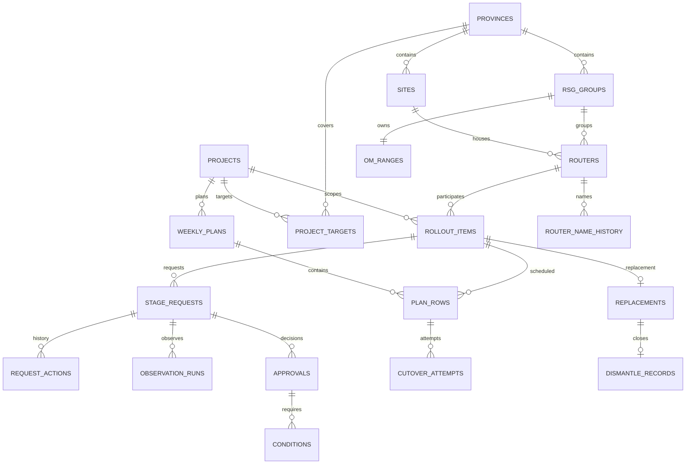

# مدل پیشنهادی داده — نسخهٔ قابل بررسی

تاریخ: ۲۰۲۶-۱۰-۱۳. وضعیت: پیشنهاد طراحی، نه Schema پیاده‌شده یا مهاجرت تأییدشده. ساختار فعلی برنامه فقط پنج جدول routers، requests، plans، events و settings دارد. این سند مدل مقصد را بر پایهٔ نیازمندی‌ها پیشنهاد می‌کند؛ تصمیم‌های باز در انتها مشخص‌اند.

## روابط اصلی

آخرین اصلاح: `PROJECT-TARGETS-AND-REPLACEMENT.md` مبنای نیازمندی است. هدف پروژه عددی است؛ فهرست مراکز مصوب در نسخهٔ فعلی وجود ندارد. این سند همچنان مدل مقصد است و روی دیتابیس اعمال نشده است.

این نمودار خلاصه است؛ جداول دسترسی، سیاست‌ها و یادآوری در جدول زیر آمده‌اند. هر روتر فقط یک عضویت فعال در پروژه دارد و سابقهٔ پروژه‌های قبلی حفظ می‌شود. چند پروژه می‌توانند در کل سامانه فعال باشند.

## جدول‌ها و فیلدهای اصلی

تمام جدول‌ها شناسهٔ داخلی پایدار دارند؛ کد سایت یا نام روتر کلید اصلی نیست. FK یعنی ارجاع به شناسهٔ جدول دیگر. نام‌های زیر پیشنهادی‌اند.

| جدول | فیلدهای اصلی | هدف |
|---|---|---|
| users / roles / user_roles | user_id، role_id، active | شخص واقعی مستقل از نقش؛ ترکیب نقش‌ها نیازمند تأیید |
| project_memberships | project_id، user_id، role_id | محدودکردن دسترسی تیم پروژه به پروژه‌های محول‌شده |
| projects / project_targets | code، title، starts_at، ends_at، status؛ project_id، province_id، target_count، version | هدف عددی طراحی به تفکیک استان؛ ثبت مازاد مجاز و گزارش‌شده |
| provinces / sites | province_id، site_code، center_name | کد یکتای سایت؛ امکان چند روتر در همان مرکز |
| router_models | vendor، model، active | کاتالوگ تجهیزات |
| routers | site_id، topology، plane، canonical_name، om_ip، model_id، rsg_group_id | هویت تجهیز؛ نام/IP تا زمان TEMP می‌توانند خالی باشند |
| rollout_items | project_id، router_id، scope_status، installed_at، created_by | مورد کاری از پیش از QA تا Handover؛ مرجع ثابت تمام مراحل |
| target_revisions | project_id، province_id، old_count، new_count، changed_by، at، reason | حفظ هدف اولیه و اصلاحات صریح طراحی؛ افزودن روتر هدف را خودکار تغییر نمی‌دهد |
| replacements | rollout_item_id، old_router_id nullable، old_router_description | هویت مستقل روتر جدید؛ روتر قدیمی می‌تواند خارج از دیتابیس باشد |
| dismantle_records | replacement_id، performed_at، project_executor_id، recorded_by، recorded_at، comment | ثبت عملیات پس از Handover؛ حذف پسوند جاری با حفظ سابقه |
| router_name_history / province_code_history | entity_id، old_value، new_value، actor_id، at، reason | هویت ثابت با نام/اختصار قابل تغییر؛ جست‌وجوی نام قبلی |
| rsg_groups / om_ranges | province_id، group_id، cidr، approved_by، approved_at | هر جفت RSG یک رنج بدون هم‌پوشانی؛ ارتباط گروه از ابتدا الزامی |
| range_requests | province_id، site_id، group_id، proposed_cidr، status، requester_id، registered_by | درخواست خودکار برای مدیر سیستم در RSG جدید؛ ثبت و فعال‌سازی فقط توسط مدیر سیستم |
| stage_requests | rollout_item_id، stage، purpose، source_approval_id، status، submitted_by، submitted_at، claimed_by، claimed_at، claim_policy_version_id | QA/TEMP/ATP/Handover؛ تمدید ATP درخواست جدا با پیوند به تأیید قبلی |
| request_actions | request_id، action، actor_id، at، comment، previous_state، new_state | ثبت مستقل Claim، برگشت، ارسال مجدد و تصمیم؛ تاریخچه بازنویسی نمی‌شود |
| findings | request_id، return_action_id، category، description، resolved_by_action_id | علت قابل توسعه؛ نوع برگشت REOBSERVE/CORRECTION_ONLY در request_actions صریح ثبت شود و مستقل از دستهٔ علت باشد |
| observation_runs | request_id، sequence، started_at، duration_seconds، policy_version_id، ended_at، outcome | هر دورهٔ TEMP جدا؛ زمان ایجاد درخواست تغییر نمی‌کند |
| approvals | request_id، reviewer_id، approved_at، approval_type، policy_version_id، valid_until، expired_at، supersedes_id | تأیید کامل/مشروط؛ اعتبار ATP از زمان تأیید، نه زمان ثبت درخواست |
| conditions | approval_id، description، responsible_team، due_at، status، resolved_action_id | پیگیری شروط مستقل از تکمیل تحویل |
| weekly_plans | project_id، week_start، timezone، status، revision، created_by، published_at | برنامهٔ هفتگی اصلی |
| plan_rows / plan_row_revisions | plan_id، rollout_item_id، planned_start، planned_end، planned_executor_id، revision، reason | مجری برنامه اختیاری؛ تاریخچهٔ جابه‌جایی و تخصیص |
| cutover_attempts | plan_row_id، started_at، ended_at، atp_approval_id، actual_executor_id، operations_actor_id، outcome | شروع و نتیجه جدا؛ هر تلاش ناموفق حفظ می‌شود؛ ATP در شروع بررسی می‌شود |
| policy_versions | policy_key، stage، value، effective_at، changed_by | تفکیک مهلت بین مراحل، مشاهدهٔ TEMP، اعتبار ATP (پیش‌فرض ۷ روز) و آستانهٔ یادآوری |
| reminders / reminder_events | rollout_item_id، request_id، rule، recipient_scope، opened_at، resolved_at، resolution_action_id | اعلان تا انجام اقدام باز می‌ماند؛ مشاهده به معنی رفع نیست |
| audit_events | actor_id، entity_type، entity_id، action، at، before، after | تاریخچهٔ تغییر داده/سیاست؛ مکمل رخدادهای فرایندی |

## قواعد لازم برای پیاده‌سازی

- یک QA اولیه برای هر مورد کاری؛ اصلاح همان درخواست را ادامه می‌دهد. QA روتر دوم به مورد کاری جدا مربوط است.
- برای هر مورد کاری و مرحله، حداکثر یک درخواست فعال؛ تمدیدهای ATP سابقهٔ مجزا دارند.
- پلین در هویت روتر ثبت می‌شود؛ تأیید آن با رخداد قابل ردیابی انجام می‌شود. از نام TH ASG/CSG نباید پلین حدس زده شود.
- تاریخ‌های submitted_at، claimed_at، observation_started_at، approved_at و cutover_started_at مستقل‌اند.
- تغییر سیاست نباید تأیید ATP منقضی‌شده را زنده کند. نسخهٔ سیاست و رخداد انقضا حفظ می‌شوند.
- Claim قبلی تحت قاعدهٔ فاصلهٔ بین مراحلِ زمان Claim ادامه دارد؛ این استثنا به دورهٔ مشاهده یا اعتبار ATP تعمیم داده نمی‌شود.
- برنامه‌ریزی پیش از QA مجاز است؛ عضویت در برنامه یا داشتن مجری، مجوز اجرای Cutover نیست.
- قید یکتایی و کنترل وضعیت باید در تراکنش پایگاه‌داده اجرا شوند؛ غیرفعال‌کردن دکمه کافی نیست.
- گزارش‌ها از درخواست‌ها، اقدام‌ها و تلاش‌ها استخراج می‌شوند؛ درصد پیشرفت هر استان = روترهای دارای Handover موفق / هدف همان استان، با سقف نمایشی ۱۰۰٪. تعداد مازاد جدا نمایش داده می‌شود؛ Replace از همان هدف حساب می‌شود و Dismantle در این کسر وارد نمی‌شود.
- عکس/چک‌لیست و اتصال به اتومیشن فعلاً پیاده نمی‌شوند؛ بعداً evidence با ارجاع به request_action یا cutover_attempt افزوده می‌شود.

## تصمیم‌های باز برای دور اول

مدت TEMP جاری ثابت، نوع برگشت صریح و یک پروژهٔ فعال برای هر روتر تأیید شده‌اند. فهرست مراکز مصوب فعلاً حذف شده و مازاد عدد هدف مجاز است. معیار تکمیل Handover است، Replace یک واحد هدف است و Dismantle مستقل گزارش می‌شود. اعتبار ATP هفت روز است و هشدار Cutover از ساعت ۰۶:۰۰ پنجرهٔ ۲۴ ساعته دارد.

باز: جزئیات طرح آیندهٔ مراکز منتخب طراحی، سیاست برخورد با چند عضویت تاریخی و قواعد دقیق برخورد با کد هنگام تغییر اختصار استان. مالک ثبت رنج، عدد ATP، روش محاسبهٔ پیشرفت و رفتار هشدار روزانه قطعی شده‌اند.

## مسیر اجرا

پس از پاسخ به سؤال‌های مرتبط، مدل به مهاجرت‌های نسخه‌دار کوچک تبدیل شود. پیش از مهاجرت از دیتابیس محلی پشتیبان تهیه شود؛ رکوردهای تکراری قبلی باید گزارش و با تصمیم مشخص تعیین تکلیف شوند، نه خودکار حذف. این سند به‌تنهایی مجوز تغییر داده‌های موجود نیست.
