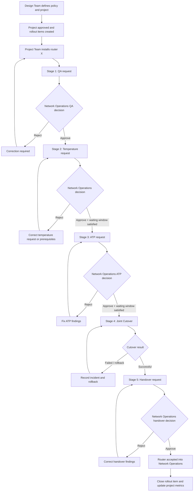

# Process Model v2 — Project, Router, QA, Cutover, and Handover

Current detail specifications: `TEMPERATURE-REQUIREMENTS.md`, `ATP-REQUIREMENTS.md`, `CUTOVER-REQUIREMENTS.md`, `ACTION-COMMENTS.md`, and `ROLE-MATRIX.md` supersede older assumptions here. Temperature observation starts on submission and lasts 48 hours; there is no additional wait before ATP. Connectivity-only corrections do not repeat the interval; temperature/CPU/fan faults require repetition. ATP has primary claims with acknowledged takeover, configurable warning thresholds, optional automation and repeated correction cycles. Cutover is scheduled by the Commissioning Leader with a named Project executor and variable Operations participant.

## 1. Scope

The system manages a project-defined rollout of routers across provinces and sites. A project is created by the Design Team and contains the planned router models, quantities, locations, topology names, and delivery targets. The Project Team installs and prepares each router. The Network Operations Team validates, approves, supports cutover, and receives the router into operations.

The system records decisions and evidence. It does not imply permission to change a router automatically; any future router integration must be separately approved.

## 2. Organizations and roles

### Design Team

- Design Manager: owns policy, project definition, standards, and design approvals.
- Design Specialist: prepares technical/design details and supports policy and project definition.

### Project Team

- Project Manager: accountable for delivery plan, scope, dates, and coordination.
- Installation Leader: coordinates installation activities and escalations.
- Commissioning Leader: coordinates commissioning, monitoring, cutover, and handover activities.
- Installation Specialist: performs or records installation and is primarily involved in Stage 1 (QA).
- Commissioning Specialist: prepares requests and participates in Stages 2–5; involved in all stages except the installation-focused Stage 1.

### Network Operations Team

- Operations Manager: owns operational policy, workflow configuration, router-model catalog, and final operational governance.
- Operations Leader: coordinates operational reviews and approvals.
- First-Line Specialist: generally participates in Stage 4 (Cutover) and operational execution.
- Second-Line Specialist: participates in all reviews, approvals, troubleshooting, and handover activities.

## 3. Business hierarchy

```text
Design policy
    └── Project (e.g., Phase 5)
          ├── target provinces / regions
          ├── planned router models and quantities
          ├── topology and site data
          └── Router rollout items (one item per router/site)
                └── versioned workflow instance
                      ├── Stage 1: Installation QA
                      ├── Stage 2: Temperature request
                      ├── Stage 3: ATP request
                      ├── Stage 4: Cutover
                      └── Stage 5: Handover
```

## 4. End-to-end workflow



## 5. Stage definitions

| Stage | Requester | Primary Network Operations action | Success result | Rejection result |
|---|---|---|---|---|
| 1. Installation QA | Installation Specialist / Project Team | Second-Line Operations reviews the installation evidence and approves or rejects with a reason | QA approved | Returned for correction with reasons |
| 2. Temperature | Commissioning Specialist / Project Team | Second-Line Operations monitors temperature, CPU, fan, and third-party monitoring readiness for 48 hours | Temperature approved and the router identity is completed | Returned to requester and Project Team with reasons |
| 3. ATP | Commissioning Specialist / Project Team | Review ATP request and findings | ATP approved and eligible for cutover | Returned for correction or retest |
| 4. Cutover | Project Team with Network Operations | Perform joint cutover and record result | Cutover completed successfully | Failed, blocked, or rolled back with incident record |
| 5. Handover | Commissioning Specialist / Project Team | Review operational handover package and accept ownership | Router handed over to Network Operations | Returned for correction |

## 6. State and transition rules

Each rollout item has one active stage at a time. A stage cannot be submitted unless the previous required stage is complete. A stage cannot be approved unless:

1. Its form is valid and all mandatory evidence is present.
2. The required prior stage is approved.
3. Any configured waiting period has elapsed.
4. The acting user has the required role and assignment.
5. No blocking incident, rollback, or unresolved correction exists.

Each stage should support at least these internal states:

```text
Not started → Draft → Submitted → In review →
Approved / Rejected / Changes requested / Cancelled / Expired
```

Stage 4 additionally requires:

```text
Scheduled → Ready → In progress → Completed / Failed / Rolled back / Blocked
```

## 7. Time-window and dependency model

The workflow must support configurable rules between stages:

- Minimum delay: e.g., Stage 3 can start only 48 hours after Stage 2 approval.
- Maximum delay: a prior approval expires after a configured period.
- Calendar policy: elapsed hours, business hours, holidays, and time zone must be configurable.
- Start event: timer starts on approval, submission, completion, or another configured event.
- Blocking behavior: prevent submission, prevent approval, or allow with an explicit override.
- Override authority: Operations Manager or another configured role.
- Override reason and audit event: mandatory for every bypass.

The timer configuration must be versioned. Changing a rule must not silently rewrite historical records. A new rule version should apply to new workflow instances or to explicitly migrated instances only.

## 8. Workflow administration model

The Operations Manager can administer a versioned workflow template:

- Enable, disable, or mark a stage as optional.
- Change stage order for future workflow versions.
- Configure minimum and maximum waiting periods.
- Define whether a stage is mandatory globally, for a project, for a router model, or for a region.
- Configure who may submit, review, approve, reject, reopen, override, and close.
- Configure required fields, evidence types, rejection reasons, and escalation targets.
- Publish a new workflow version with an effective date.
- Retire a version for new work while preserving historical read-only behavior.

The UI must warn that deleting or reordering a stage affects future work. Historical workflow instances must preserve the version and rules under which they ran.

## 9. Recommended data concepts

```text
Project
  └── ProjectRouterItem
        ├── RouterModel
        ├── Site / Province
        ├── TopologyIdentity
        └── WorkflowInstance
              ├── WorkflowVersion
              ├── StageInstance[]
              ├── Evidence[]
              ├── Decision[]
              ├── Timer / SLA records
              └── AuditEvent[]
```

## 10. Action comments and evidence

Every action that changes a request must support a separate comment and evidence context. Comments are not one free-text field on the overall record.

```text
ActionComment
  ├── rollout_item_id
  ├── stage_instance_id
  ├── action_id
  ├── action_type (SUBMIT, APPROVE, REJECT, RETURN, OVERRIDE, REOPEN, COMPLETE, ...)
  ├── author and role
  ├── created_at
  ├── comment_text
  └── attachments/evidence references
```

The application must allow users with permission to retrieve comments grouped by stage, action, actor, and time. Append-only comments with correction entries are a proposal; edit/delete policy remains to be confirmed.

## 11. Design constraints

- A rejection returns the same stage to correction unless the configured policy says otherwise.
- Every decision must record actor, role, timestamp, reason, evidence, and resulting state.
- A user must not approve their own request where separation of duties is required.
- Stage 4 must record the joint participants, start/end times, result, incidents, and rollback decision.
- Handover approval transfers operational ownership but does not erase project ownership or history.

## 12. Open questions before form design

1. What exactly is checked in Installation QA, and what evidence is mandatory?
2. What does “Temperature” mean operationally, and what data must its form capture?
3. What does ATP stand for in this organization, and what are its test cases and pass/fail rules?
4. Is Stage 2 a fixed operational request, a temperature-monitoring period, or a named internal approval process?
5. What are the exact approval roles for each stage, and can the requester also be the reviewer?
6. Is a rejected stage edited and resubmitted, or is a new revision created?
7. What is the minimum and maximum time between every pair of stages?
8. Are waiting periods measured in calendar hours or working hours, and which time zone/holiday calendar applies?
9. Which stages can be skipped, and under what authority and reason?
10. What is the exact handover package and acceptance checklist?
11. What identifies a router uniquely: serial number, management IP, hostname, site code, or a combination?
12. Which fields belong to the project, the site, the router model, and the individual rollout item?
13. What information must be visible to Design, Project, and Operations users?
14. Which reports and alerts are required for overdue, rejected, blocked, or failed items?
15. What is the target Linux distribution, CPU architecture, container engine, and offline transfer medium?
